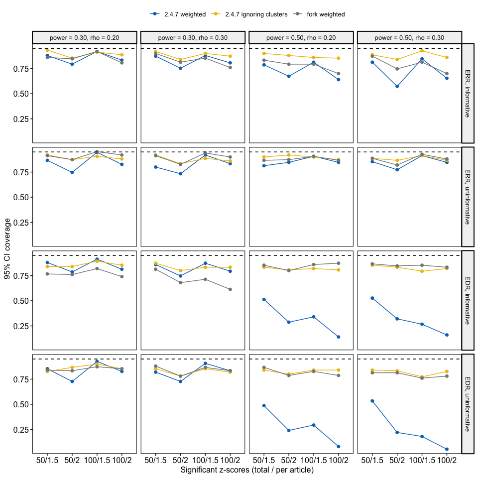
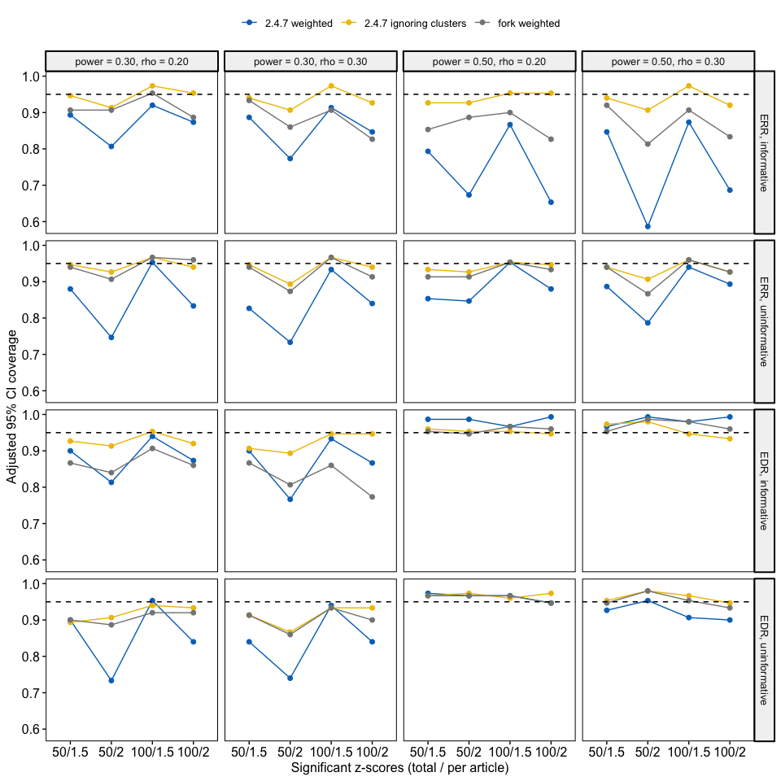
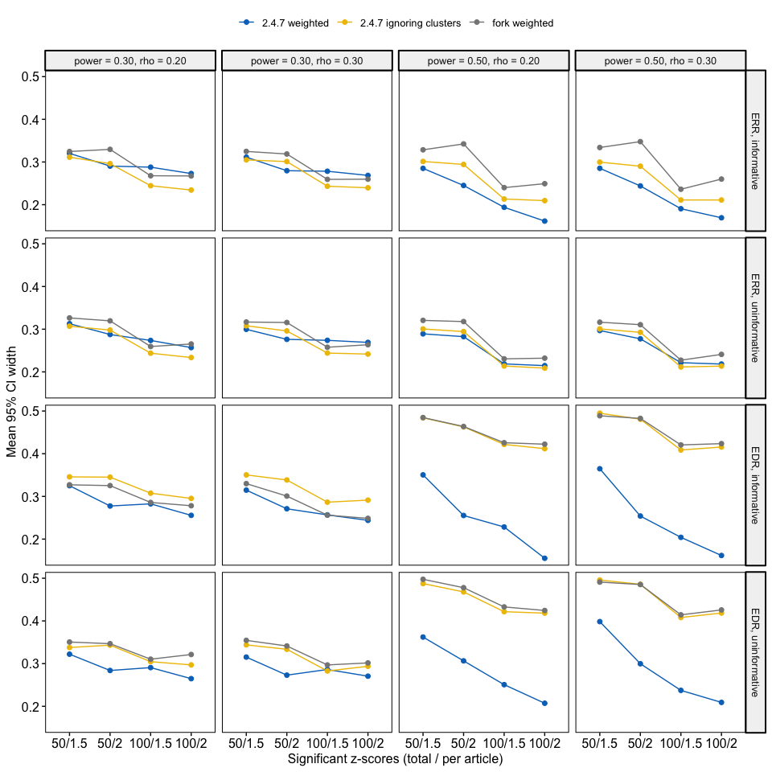
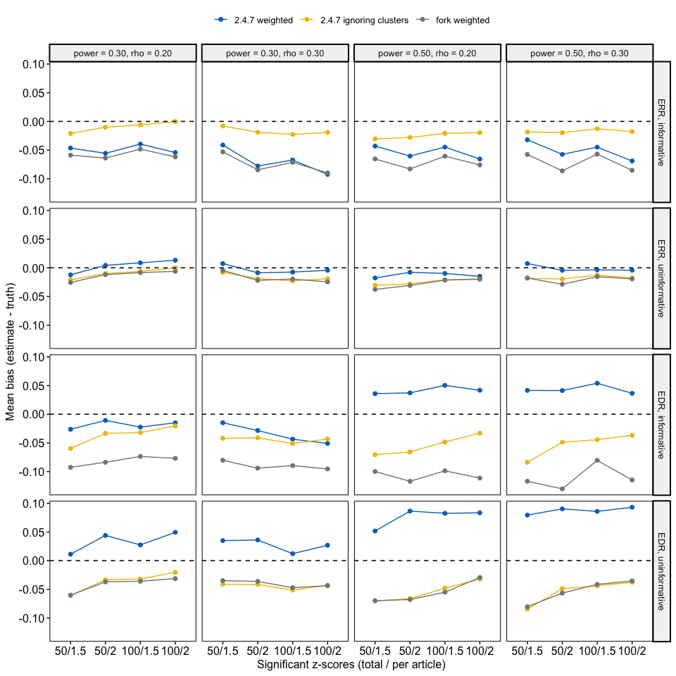
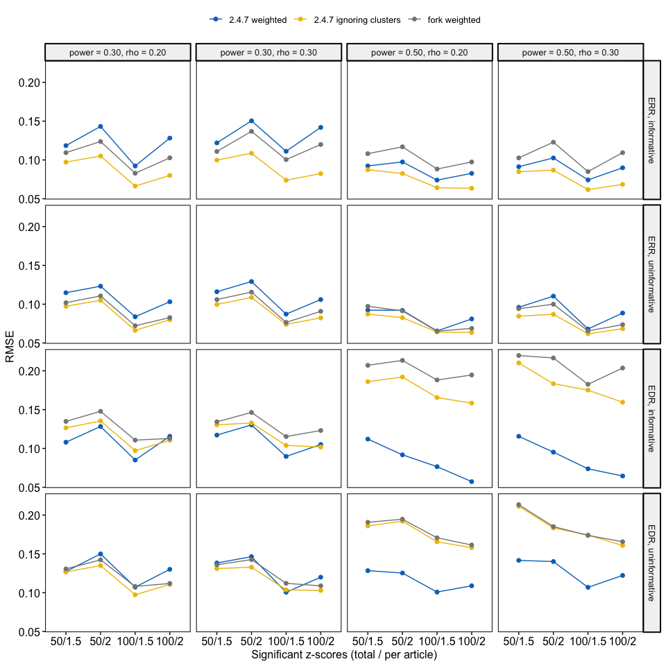

# zcurve weighted clustering: simulation results


- [How to run](#how-to-run)
- [Methods](#methods)
- [Overall](#overall)
- [By scenario](#by-scenario)
  - [Coverage](#coverage)
  - [Adjusted coverage](#adjusted-coverage)
  - [CI width](#ci-width)
  - [Bias](#bias)
  - [RMSE](#rmse)
- [Full table](#full-table)

*The simulation code, results and this write-up were generated by Claude
Opus 5.5.*

This page summarises the simulations for
[FBartos/zcurve#33](https://github.com/FBartos/zcurve/issues/33):
`zcurve_clustered(method = "w")` overestimated ERR and EDR. The weighted
EM multiplied each mixture component’s log-density by the article weight
before mixing the components, i.e. it used $\theta_k f_k(z)^{w}$ instead
of $\left(\sum_k \theta_k f_k(z)\right)^{w}$. This flattens the
component densities rather than down-weighting the observation, and
pulls the mixture weights towards the high-power components.

## How to run

Run everything from `simulations/`:

``` zsh
./run_all.sh all old unclustered fork   # every dataset, all versions
./run_all.sh                            # every dataset, fork only
./run_all.sh 36                         # quick check on the first 36 datasets, fork only
quarto render results.qmd               # rebuild results.html and README.md
```

`run_all.sh` regenerates `output/sim_data.rds` when `gen_data.R` has
changed, installs the fork from the `fix-issue-33` branch of
[shaheedazaad/zcurve](https://github.com/shaheedazaad/zcurve) into
`../lib/fork` (so push changes to the fork first), fits the chosen
versions and runs `compare.R`. By default only the fork is refitted;
existing results for the other versions are kept and still compared.
After changing `gen_data.R`, refit all versions so they use the same
data.

Settings:

- **Number of simulations per scenario**: `n_sims` at the top of
  `gen_data.R`. The scenario grid (power mixtures, `rhos`,
  `total_sig_k`, `av_sig_k_per_a`) is set just below it.
- **Number of bootstraps per fit**: `n_boot` near the top of `fit.R`.

## Methods

Data are generated by `gen_data.R`. Each article has 1 + Poisson
attempted tests, and z-scores within an article share an error term with
correlation `rho`. Only significant z-scores are kept, and articles are
added until the dataset reaches the target number of significant
results. Each article draws its power with equal probability from a
three-point mixture, {0.1, 0.3, 0.5} (mean 0.3) or {0.2, 0.5, 0.8} (mean
0.5), and all tests within an article share that power. The `power`
setting refers to the mixture mean. The true ERR and EDR are averaged
over this mixture across all attempted tests.

In these datasets cluster size is **informative**: high-power articles
produce more significant z-scores, so the number of z-scores in an
article depends on its power. Weighting each z-score by 1 / (number of
z-scores in its article) then down-weights high-power articles, and the
weighted fit estimates an article-level rather than a test-level ERR and
EDR. To separate this from the bug, every dataset also has an
**uninformative** copy in which the z-scores are shuffled across
articles: each article keeps its number of z-scores, but that number no
longer depends on power. The shuffling also removes the within-article
correlation, so `rho` only affects the informative datasets. The true
ERR and EDR are the same for both copies.

Each of the 32 scenarios was simulated 150 times and fitted with `fit.R`
(`n_boot` bootstraps as set in `fit.R`, 95% percentile intervals) by
three versions:

- **2.4.7 weighted**: CRAN zcurve 2.4.7,
  `zcurve_clustered(method = "w")`.
- **2.4.7 ignoring clusters**: CRAN zcurve 2.4.7,
  `zcurve(method = "EM")` treating every z-score as independent.
- **fork weighted**: the fork, where `zcurve_clustered(method = "w")`
  keeps the component densities unweighted and applies each z-score’s
  weight (1 / number of z-scores in its article) to its contribution to
  the log-likelihood and to the mixture-weight update. Its bootstrap
  resamples articles with replacement, keeping all of their z-scores and
  their original weights.

In 2.4.7, the weighted bootstrap resamples individual z-scores (keeping
their weights), not articles, so its CIs ignore between-article
variability.

Coverage is reported for two intervals. **Raw** is the 95% percentile
bootstrap interval. **Adjusted** is the interval that `summary()`
reports: the percentile interval widened by .03 for ERR and .05 for EDR,
as proposed by Bartoš & Schimmack, bounded below by .025 (ERR) and .05
(EDR) and above by 1. The adjusted intervals are computed from the raw
bounds, so no extra fitting is needed.

Two fork fits (datasets 2984 and 4682) failed in the full run because
the parallel workers failed to start. They were refitted with the same
code and seeds, and their rows replaced in `output/results_fork.csv`.

With 150 simulations per scenario, the Monte Carlo standard error of a
95% coverage estimate is about 0.018.

## Overall

| Cluster size | Version | Fits | Failed | ERR bias | ERR coverage | ERR adj. coverage | ERR CI width | EDR bias | EDR coverage | EDR adj. coverage | EDR CI width |
|:---|:---|---:|---:|---:|---:|---:|---:|---:|---:|---:|---:|
| informative | 2.4.7 weighted | 2400 | 0 | -0.056 | 0.784 | 0.806 | 0.255 | 0.008 | 0.576 | 0.929 | 0.263 |
| informative | 2.4.7 ignoring clusters | 2400 | 0 | -0.017 | 0.883 | 0.940 | 0.263 | -0.047 | 0.833 | 0.941 | 0.384 |
| informative | fork weighted | 2400 | 0 | -0.069 | 0.813 | 0.882 | 0.293 | -0.097 | 0.793 | 0.905 | 0.373 |
| uninformative | 2.4.7 weighted | 2400 | 0 | -0.003 | 0.842 | 0.862 | 0.267 | 0.056 | 0.544 | 0.895 | 0.286 |
| uninformative | 2.4.7 ignoring clusters | 2400 | 0 | -0.017 | 0.888 | 0.939 | 0.263 | -0.047 | 0.834 | 0.940 | 0.384 |
| uninformative | fork weighted | 2400 | 0 | -0.020 | 0.892 | 0.930 | 0.283 | -0.048 | 0.825 | 0.931 | 0.392 |

## By scenario

Each column is one combination of power and within-article correlation,
and each row one estimand and cluster size; the x-axis varies the
dataset size and the average number of significant z-scores per article.

### Coverage



### Adjusted coverage



### CI width



### Bias



### RMSE



## Full table

| label | cluster_size | power | rho | total_sig_k | av_sig_k_per_a | n | n_failed | ERR_bias | ERR_rmse | ERR_coverage | ERR_coverage_adj | ERR_width | EDR_bias | EDR_rmse | EDR_coverage | EDR_coverage_adj | EDR_width |
|:---|:---|---:|---:|---:|---:|---:|---:|---:|---:|---:|---:|---:|---:|---:|---:|---:|---:|
| 2.4.7 weighted | informative | 0.3 | 0.2 | 50 | 1.5 | 150 | 0 | -0.046 | 0.118 | 0.880 | 0.893 | 0.320 | -0.026 | 0.108 | 0.880 | 0.900 | 0.325 |
| 2.4.7 ignoring clusters | informative | 0.3 | 0.2 | 50 | 1.5 | 150 | 0 | -0.021 | 0.097 | 0.933 | 0.947 | 0.311 | -0.060 | 0.127 | 0.840 | 0.927 | 0.346 |
| fork weighted | informative | 0.3 | 0.2 | 50 | 1.5 | 150 | 0 | -0.059 | 0.109 | 0.860 | 0.907 | 0.325 | -0.092 | 0.135 | 0.767 | 0.867 | 0.327 |
| 2.4.7 weighted | informative | 0.3 | 0.2 | 50 | 2.0 | 150 | 0 | -0.056 | 0.143 | 0.793 | 0.807 | 0.290 | -0.011 | 0.128 | 0.787 | 0.813 | 0.278 |
| 2.4.7 ignoring clusters | informative | 0.3 | 0.2 | 50 | 2.0 | 150 | 0 | -0.010 | 0.105 | 0.853 | 0.913 | 0.296 | -0.033 | 0.135 | 0.840 | 0.913 | 0.345 |
| fork weighted | informative | 0.3 | 0.2 | 50 | 2.0 | 150 | 0 | -0.064 | 0.124 | 0.847 | 0.907 | 0.330 | -0.084 | 0.148 | 0.760 | 0.840 | 0.325 |
| 2.4.7 weighted | informative | 0.3 | 0.2 | 100 | 1.5 | 150 | 0 | -0.039 | 0.092 | 0.920 | 0.920 | 0.288 | -0.022 | 0.085 | 0.913 | 0.940 | 0.283 |
| 2.4.7 ignoring clusters | informative | 0.3 | 0.2 | 100 | 1.5 | 150 | 0 | -0.006 | 0.066 | 0.913 | 0.973 | 0.244 | -0.032 | 0.097 | 0.893 | 0.953 | 0.308 |
| fork weighted | informative | 0.3 | 0.2 | 100 | 1.5 | 150 | 0 | -0.048 | 0.083 | 0.920 | 0.953 | 0.268 | -0.074 | 0.111 | 0.820 | 0.907 | 0.286 |
| 2.4.7 weighted | informative | 0.3 | 0.2 | 100 | 2.0 | 150 | 0 | -0.054 | 0.128 | 0.833 | 0.873 | 0.273 | -0.015 | 0.116 | 0.813 | 0.873 | 0.256 |
| 2.4.7 ignoring clusters | informative | 0.3 | 0.2 | 100 | 2.0 | 150 | 0 | 0.000 | 0.080 | 0.887 | 0.953 | 0.234 | -0.020 | 0.111 | 0.853 | 0.920 | 0.295 |
| fork weighted | informative | 0.3 | 0.2 | 100 | 2.0 | 150 | 0 | -0.062 | 0.103 | 0.807 | 0.887 | 0.267 | -0.077 | 0.113 | 0.740 | 0.860 | 0.278 |
| 2.4.7 weighted | informative | 0.3 | 0.3 | 50 | 1.5 | 150 | 0 | -0.041 | 0.122 | 0.873 | 0.887 | 0.311 | -0.015 | 0.117 | 0.860 | 0.900 | 0.315 |
| 2.4.7 ignoring clusters | informative | 0.3 | 0.3 | 50 | 1.5 | 150 | 0 | -0.008 | 0.100 | 0.920 | 0.940 | 0.305 | -0.042 | 0.130 | 0.873 | 0.907 | 0.350 |
| fork weighted | informative | 0.3 | 0.3 | 50 | 1.5 | 150 | 0 | -0.053 | 0.111 | 0.900 | 0.933 | 0.325 | -0.080 | 0.134 | 0.813 | 0.867 | 0.330 |
| 2.4.7 weighted | informative | 0.3 | 0.3 | 50 | 2.0 | 150 | 0 | -0.078 | 0.150 | 0.753 | 0.773 | 0.280 | -0.028 | 0.130 | 0.747 | 0.767 | 0.271 |
| 2.4.7 ignoring clusters | informative | 0.3 | 0.3 | 50 | 2.0 | 150 | 0 | -0.019 | 0.109 | 0.840 | 0.907 | 0.301 | -0.041 | 0.133 | 0.800 | 0.893 | 0.339 |
| fork weighted | informative | 0.3 | 0.3 | 50 | 2.0 | 150 | 0 | -0.084 | 0.137 | 0.813 | 0.860 | 0.319 | -0.094 | 0.146 | 0.680 | 0.807 | 0.301 |
| 2.4.7 weighted | informative | 0.3 | 0.3 | 100 | 1.5 | 150 | 0 | -0.067 | 0.111 | 0.880 | 0.913 | 0.278 | -0.043 | 0.090 | 0.873 | 0.933 | 0.257 |
| 2.4.7 ignoring clusters | informative | 0.3 | 0.3 | 100 | 1.5 | 150 | 0 | -0.023 | 0.074 | 0.900 | 0.973 | 0.243 | -0.051 | 0.104 | 0.833 | 0.947 | 0.287 |
| fork weighted | informative | 0.3 | 0.3 | 100 | 1.5 | 150 | 0 | -0.071 | 0.100 | 0.853 | 0.907 | 0.259 | -0.089 | 0.115 | 0.713 | 0.860 | 0.256 |
| 2.4.7 weighted | informative | 0.3 | 0.3 | 100 | 2.0 | 150 | 0 | -0.092 | 0.142 | 0.807 | 0.847 | 0.269 | -0.051 | 0.105 | 0.793 | 0.867 | 0.244 |
| 2.4.7 ignoring clusters | informative | 0.3 | 0.3 | 100 | 2.0 | 150 | 0 | -0.019 | 0.082 | 0.873 | 0.927 | 0.240 | -0.043 | 0.102 | 0.833 | 0.947 | 0.291 |
| fork weighted | informative | 0.3 | 0.3 | 100 | 2.0 | 150 | 0 | -0.090 | 0.120 | 0.760 | 0.827 | 0.260 | -0.095 | 0.123 | 0.613 | 0.773 | 0.249 |
| 2.4.7 weighted | informative | 0.5 | 0.2 | 50 | 1.5 | 150 | 0 | -0.043 | 0.092 | 0.787 | 0.793 | 0.285 | 0.036 | 0.112 | 0.513 | 0.987 | 0.350 |
| 2.4.7 ignoring clusters | informative | 0.5 | 0.2 | 50 | 1.5 | 150 | 0 | -0.030 | 0.087 | 0.900 | 0.927 | 0.301 | -0.071 | 0.186 | 0.833 | 0.960 | 0.484 |
| fork weighted | informative | 0.5 | 0.2 | 50 | 1.5 | 150 | 0 | -0.065 | 0.108 | 0.833 | 0.853 | 0.329 | -0.100 | 0.207 | 0.853 | 0.953 | 0.485 |
| 2.4.7 weighted | informative | 0.5 | 0.2 | 50 | 2.0 | 150 | 0 | -0.060 | 0.097 | 0.673 | 0.673 | 0.245 | 0.037 | 0.092 | 0.287 | 0.987 | 0.255 |
| 2.4.7 ignoring clusters | informative | 0.5 | 0.2 | 50 | 2.0 | 150 | 0 | -0.028 | 0.082 | 0.880 | 0.927 | 0.294 | -0.066 | 0.192 | 0.807 | 0.953 | 0.463 |
| fork weighted | informative | 0.5 | 0.2 | 50 | 2.0 | 150 | 0 | -0.083 | 0.117 | 0.793 | 0.887 | 0.342 | -0.117 | 0.213 | 0.800 | 0.947 | 0.464 |
| 2.4.7 weighted | informative | 0.5 | 0.2 | 100 | 1.5 | 150 | 0 | -0.045 | 0.074 | 0.813 | 0.867 | 0.194 | 0.050 | 0.077 | 0.340 | 0.967 | 0.228 |
| 2.4.7 ignoring clusters | informative | 0.5 | 0.2 | 100 | 1.5 | 150 | 0 | -0.021 | 0.064 | 0.860 | 0.953 | 0.213 | -0.048 | 0.166 | 0.820 | 0.953 | 0.422 |
| fork weighted | informative | 0.5 | 0.2 | 100 | 1.5 | 150 | 0 | -0.061 | 0.088 | 0.793 | 0.900 | 0.240 | -0.099 | 0.188 | 0.860 | 0.967 | 0.426 |
| 2.4.7 weighted | informative | 0.5 | 0.2 | 100 | 2.0 | 150 | 0 | -0.065 | 0.083 | 0.640 | 0.653 | 0.162 | 0.042 | 0.057 | 0.140 | 0.993 | 0.155 |
| 2.4.7 ignoring clusters | informative | 0.5 | 0.2 | 100 | 2.0 | 150 | 0 | -0.019 | 0.064 | 0.853 | 0.953 | 0.210 | -0.033 | 0.158 | 0.807 | 0.947 | 0.412 |
| fork weighted | informative | 0.5 | 0.2 | 100 | 2.0 | 150 | 0 | -0.076 | 0.097 | 0.700 | 0.827 | 0.249 | -0.111 | 0.195 | 0.873 | 0.960 | 0.422 |
| 2.4.7 weighted | informative | 0.5 | 0.3 | 50 | 1.5 | 150 | 0 | -0.032 | 0.091 | 0.813 | 0.847 | 0.285 | 0.042 | 0.116 | 0.527 | 0.967 | 0.365 |
| 2.4.7 ignoring clusters | informative | 0.5 | 0.3 | 50 | 1.5 | 150 | 0 | -0.018 | 0.085 | 0.887 | 0.940 | 0.300 | -0.084 | 0.210 | 0.853 | 0.973 | 0.495 |
| fork weighted | informative | 0.5 | 0.3 | 50 | 1.5 | 150 | 0 | -0.058 | 0.103 | 0.873 | 0.920 | 0.334 | -0.117 | 0.220 | 0.867 | 0.953 | 0.489 |
| 2.4.7 weighted | informative | 0.5 | 0.3 | 50 | 2.0 | 150 | 0 | -0.057 | 0.103 | 0.573 | 0.587 | 0.244 | 0.041 | 0.095 | 0.320 | 0.993 | 0.254 |
| 2.4.7 ignoring clusters | informative | 0.5 | 0.3 | 50 | 2.0 | 150 | 0 | -0.020 | 0.087 | 0.840 | 0.907 | 0.290 | -0.049 | 0.183 | 0.833 | 0.980 | 0.481 |
| fork weighted | informative | 0.5 | 0.3 | 50 | 2.0 | 150 | 0 | -0.086 | 0.123 | 0.747 | 0.813 | 0.348 | -0.130 | 0.217 | 0.847 | 0.987 | 0.483 |
| 2.4.7 weighted | informative | 0.5 | 0.3 | 100 | 1.5 | 150 | 0 | -0.045 | 0.074 | 0.847 | 0.873 | 0.191 | 0.054 | 0.074 | 0.267 | 0.980 | 0.204 |
| 2.4.7 ignoring clusters | informative | 0.5 | 0.3 | 100 | 1.5 | 150 | 0 | -0.013 | 0.062 | 0.927 | 0.973 | 0.211 | -0.044 | 0.175 | 0.793 | 0.947 | 0.409 |
| fork weighted | informative | 0.5 | 0.3 | 100 | 1.5 | 150 | 0 | -0.057 | 0.085 | 0.813 | 0.907 | 0.236 | -0.080 | 0.183 | 0.853 | 0.980 | 0.421 |
| 2.4.7 weighted | informative | 0.5 | 0.3 | 100 | 2.0 | 150 | 0 | -0.069 | 0.090 | 0.653 | 0.687 | 0.169 | 0.036 | 0.065 | 0.160 | 0.993 | 0.162 |
| 2.4.7 ignoring clusters | informative | 0.5 | 0.3 | 100 | 2.0 | 150 | 0 | -0.018 | 0.069 | 0.860 | 0.920 | 0.211 | -0.037 | 0.160 | 0.820 | 0.933 | 0.416 |
| fork weighted | informative | 0.5 | 0.3 | 100 | 2.0 | 150 | 0 | -0.085 | 0.109 | 0.700 | 0.833 | 0.260 | -0.115 | 0.204 | 0.833 | 0.960 | 0.424 |
| 2.4.7 weighted | uninformative | 0.3 | 0.2 | 50 | 1.5 | 150 | 0 | -0.012 | 0.115 | 0.867 | 0.880 | 0.313 | 0.011 | 0.127 | 0.853 | 0.900 | 0.322 |
| 2.4.7 ignoring clusters | uninformative | 0.3 | 0.2 | 50 | 1.5 | 150 | 0 | -0.021 | 0.097 | 0.920 | 0.947 | 0.307 | -0.061 | 0.127 | 0.827 | 0.893 | 0.338 |
| fork weighted | uninformative | 0.3 | 0.2 | 50 | 1.5 | 150 | 0 | -0.026 | 0.102 | 0.913 | 0.940 | 0.326 | -0.060 | 0.131 | 0.840 | 0.900 | 0.351 |
| 2.4.7 weighted | uninformative | 0.3 | 0.2 | 50 | 2.0 | 150 | 0 | 0.004 | 0.123 | 0.747 | 0.747 | 0.288 | 0.044 | 0.150 | 0.727 | 0.733 | 0.284 |
| 2.4.7 ignoring clusters | uninformative | 0.3 | 0.2 | 50 | 2.0 | 150 | 0 | -0.010 | 0.105 | 0.873 | 0.927 | 0.298 | -0.033 | 0.135 | 0.867 | 0.907 | 0.343 |
| fork weighted | uninformative | 0.3 | 0.2 | 50 | 2.0 | 150 | 0 | -0.012 | 0.111 | 0.873 | 0.907 | 0.320 | -0.037 | 0.142 | 0.833 | 0.887 | 0.347 |
| 2.4.7 weighted | uninformative | 0.3 | 0.2 | 100 | 1.5 | 150 | 0 | 0.009 | 0.084 | 0.947 | 0.953 | 0.274 | 0.027 | 0.107 | 0.927 | 0.953 | 0.291 |
| 2.4.7 ignoring clusters | uninformative | 0.3 | 0.2 | 100 | 1.5 | 150 | 0 | -0.006 | 0.066 | 0.907 | 0.967 | 0.244 | -0.032 | 0.097 | 0.900 | 0.940 | 0.305 |
| fork weighted | uninformative | 0.3 | 0.2 | 100 | 1.5 | 150 | 0 | -0.008 | 0.072 | 0.953 | 0.967 | 0.259 | -0.036 | 0.108 | 0.873 | 0.920 | 0.310 |
| 2.4.7 weighted | uninformative | 0.3 | 0.2 | 100 | 2.0 | 150 | 0 | 0.013 | 0.103 | 0.827 | 0.833 | 0.257 | 0.049 | 0.130 | 0.827 | 0.840 | 0.265 |
| 2.4.7 ignoring clusters | uninformative | 0.3 | 0.2 | 100 | 2.0 | 150 | 0 | 0.000 | 0.080 | 0.880 | 0.940 | 0.234 | -0.020 | 0.111 | 0.853 | 0.933 | 0.297 |
| fork weighted | uninformative | 0.3 | 0.2 | 100 | 2.0 | 150 | 0 | -0.006 | 0.083 | 0.920 | 0.960 | 0.265 | -0.031 | 0.112 | 0.853 | 0.920 | 0.321 |
| 2.4.7 weighted | uninformative | 0.3 | 0.3 | 50 | 1.5 | 150 | 0 | 0.007 | 0.116 | 0.800 | 0.827 | 0.300 | 0.035 | 0.138 | 0.820 | 0.840 | 0.315 |
| 2.4.7 ignoring clusters | uninformative | 0.3 | 0.3 | 50 | 1.5 | 150 | 0 | -0.008 | 0.100 | 0.920 | 0.947 | 0.308 | -0.041 | 0.131 | 0.853 | 0.913 | 0.344 |
| fork weighted | uninformative | 0.3 | 0.3 | 50 | 1.5 | 150 | 0 | -0.005 | 0.106 | 0.913 | 0.940 | 0.317 | -0.035 | 0.136 | 0.880 | 0.913 | 0.354 |
| 2.4.7 weighted | uninformative | 0.3 | 0.3 | 50 | 2.0 | 150 | 0 | -0.009 | 0.129 | 0.733 | 0.733 | 0.276 | 0.036 | 0.146 | 0.727 | 0.740 | 0.273 |
| 2.4.7 ignoring clusters | uninformative | 0.3 | 0.3 | 50 | 2.0 | 150 | 0 | -0.019 | 0.109 | 0.833 | 0.893 | 0.296 | -0.042 | 0.133 | 0.780 | 0.867 | 0.334 |
| fork weighted | uninformative | 0.3 | 0.3 | 50 | 2.0 | 150 | 0 | -0.022 | 0.116 | 0.827 | 0.873 | 0.316 | -0.036 | 0.143 | 0.780 | 0.860 | 0.341 |
| 2.4.7 weighted | uninformative | 0.3 | 0.3 | 100 | 1.5 | 150 | 0 | -0.007 | 0.087 | 0.920 | 0.933 | 0.274 | 0.012 | 0.101 | 0.907 | 0.940 | 0.286 |
| 2.4.7 ignoring clusters | uninformative | 0.3 | 0.3 | 100 | 1.5 | 150 | 0 | -0.023 | 0.074 | 0.887 | 0.967 | 0.244 | -0.051 | 0.104 | 0.853 | 0.933 | 0.283 |
| fork weighted | uninformative | 0.3 | 0.3 | 100 | 1.5 | 150 | 0 | -0.020 | 0.077 | 0.940 | 0.967 | 0.258 | -0.047 | 0.112 | 0.867 | 0.933 | 0.297 |
| 2.4.7 weighted | uninformative | 0.3 | 0.3 | 100 | 2.0 | 150 | 0 | -0.004 | 0.106 | 0.833 | 0.840 | 0.269 | 0.027 | 0.120 | 0.833 | 0.840 | 0.271 |
| 2.4.7 ignoring clusters | uninformative | 0.3 | 0.3 | 100 | 2.0 | 150 | 0 | -0.019 | 0.082 | 0.860 | 0.940 | 0.242 | -0.043 | 0.103 | 0.820 | 0.933 | 0.294 |
| fork weighted | uninformative | 0.3 | 0.3 | 100 | 2.0 | 150 | 0 | -0.024 | 0.091 | 0.900 | 0.913 | 0.264 | -0.044 | 0.109 | 0.833 | 0.900 | 0.302 |
| 2.4.7 weighted | uninformative | 0.5 | 0.2 | 50 | 1.5 | 150 | 0 | -0.018 | 0.092 | 0.813 | 0.853 | 0.289 | 0.052 | 0.128 | 0.487 | 0.973 | 0.362 |
| 2.4.7 ignoring clusters | uninformative | 0.5 | 0.2 | 50 | 1.5 | 150 | 0 | -0.030 | 0.087 | 0.900 | 0.933 | 0.301 | -0.070 | 0.186 | 0.840 | 0.967 | 0.488 |
| fork weighted | uninformative | 0.5 | 0.2 | 50 | 1.5 | 150 | 0 | -0.038 | 0.097 | 0.867 | 0.913 | 0.321 | -0.070 | 0.191 | 0.867 | 0.967 | 0.498 |
| 2.4.7 weighted | uninformative | 0.5 | 0.2 | 50 | 2.0 | 150 | 0 | -0.008 | 0.092 | 0.847 | 0.847 | 0.283 | 0.086 | 0.125 | 0.240 | 0.967 | 0.306 |
| 2.4.7 ignoring clusters | uninformative | 0.5 | 0.2 | 50 | 2.0 | 150 | 0 | -0.028 | 0.083 | 0.920 | 0.927 | 0.294 | -0.066 | 0.192 | 0.800 | 0.973 | 0.468 |
| fork weighted | uninformative | 0.5 | 0.2 | 50 | 2.0 | 150 | 0 | -0.031 | 0.091 | 0.873 | 0.913 | 0.318 | -0.068 | 0.195 | 0.787 | 0.967 | 0.478 |
| 2.4.7 weighted | uninformative | 0.5 | 0.2 | 100 | 1.5 | 150 | 0 | -0.010 | 0.066 | 0.907 | 0.953 | 0.219 | 0.082 | 0.101 | 0.293 | 0.967 | 0.251 |
| 2.4.7 ignoring clusters | uninformative | 0.5 | 0.2 | 100 | 1.5 | 150 | 0 | -0.021 | 0.064 | 0.900 | 0.953 | 0.214 | -0.048 | 0.166 | 0.840 | 0.960 | 0.422 |
| fork weighted | uninformative | 0.5 | 0.2 | 100 | 1.5 | 150 | 0 | -0.021 | 0.065 | 0.907 | 0.953 | 0.231 | -0.055 | 0.171 | 0.827 | 0.967 | 0.433 |
| 2.4.7 weighted | uninformative | 0.5 | 0.2 | 100 | 2.0 | 150 | 0 | -0.015 | 0.081 | 0.847 | 0.880 | 0.215 | 0.083 | 0.109 | 0.080 | 0.947 | 0.207 |
| 2.4.7 ignoring clusters | uninformative | 0.5 | 0.2 | 100 | 2.0 | 150 | 0 | -0.020 | 0.064 | 0.873 | 0.947 | 0.209 | -0.032 | 0.158 | 0.840 | 0.973 | 0.418 |
| fork weighted | uninformative | 0.5 | 0.2 | 100 | 2.0 | 150 | 0 | -0.020 | 0.069 | 0.867 | 0.933 | 0.232 | -0.029 | 0.161 | 0.787 | 0.947 | 0.425 |
| 2.4.7 weighted | uninformative | 0.5 | 0.3 | 50 | 1.5 | 150 | 0 | 0.007 | 0.096 | 0.853 | 0.887 | 0.297 | 0.079 | 0.142 | 0.533 | 0.927 | 0.398 |
| 2.4.7 ignoring clusters | uninformative | 0.5 | 0.3 | 50 | 1.5 | 150 | 0 | -0.018 | 0.085 | 0.887 | 0.940 | 0.301 | -0.084 | 0.211 | 0.840 | 0.953 | 0.496 |
| fork weighted | uninformative | 0.5 | 0.3 | 50 | 1.5 | 150 | 0 | -0.018 | 0.094 | 0.887 | 0.940 | 0.316 | -0.080 | 0.213 | 0.813 | 0.947 | 0.491 |
| 2.4.7 weighted | uninformative | 0.5 | 0.3 | 50 | 2.0 | 150 | 0 | -0.004 | 0.110 | 0.773 | 0.787 | 0.278 | 0.090 | 0.140 | 0.220 | 0.953 | 0.300 |
| 2.4.7 ignoring clusters | uninformative | 0.5 | 0.3 | 50 | 2.0 | 150 | 0 | -0.019 | 0.087 | 0.867 | 0.907 | 0.293 | -0.049 | 0.183 | 0.833 | 0.980 | 0.486 |
| fork weighted | uninformative | 0.5 | 0.3 | 50 | 2.0 | 150 | 0 | -0.029 | 0.100 | 0.820 | 0.867 | 0.311 | -0.057 | 0.185 | 0.813 | 0.980 | 0.485 |
| 2.4.7 weighted | uninformative | 0.5 | 0.3 | 100 | 1.5 | 150 | 0 | -0.004 | 0.068 | 0.913 | 0.940 | 0.222 | 0.086 | 0.107 | 0.180 | 0.907 | 0.237 |
| 2.4.7 ignoring clusters | uninformative | 0.5 | 0.3 | 100 | 1.5 | 150 | 0 | -0.013 | 0.062 | 0.913 | 0.960 | 0.212 | -0.044 | 0.174 | 0.773 | 0.967 | 0.408 |
| fork weighted | uninformative | 0.5 | 0.3 | 100 | 1.5 | 150 | 0 | -0.015 | 0.066 | 0.927 | 0.960 | 0.227 | -0.041 | 0.174 | 0.760 | 0.953 | 0.414 |
| 2.4.7 weighted | uninformative | 0.5 | 0.3 | 100 | 2.0 | 150 | 0 | -0.004 | 0.089 | 0.847 | 0.893 | 0.218 | 0.093 | 0.122 | 0.053 | 0.900 | 0.209 |
| 2.4.7 ignoring clusters | uninformative | 0.5 | 0.3 | 100 | 2.0 | 150 | 0 | -0.017 | 0.068 | 0.867 | 0.927 | 0.214 | -0.038 | 0.161 | 0.827 | 0.947 | 0.419 |
| fork weighted | uninformative | 0.5 | 0.3 | 100 | 2.0 | 150 | 0 | -0.019 | 0.074 | 0.880 | 0.927 | 0.241 | -0.035 | 0.166 | 0.780 | 0.933 | 0.426 |
